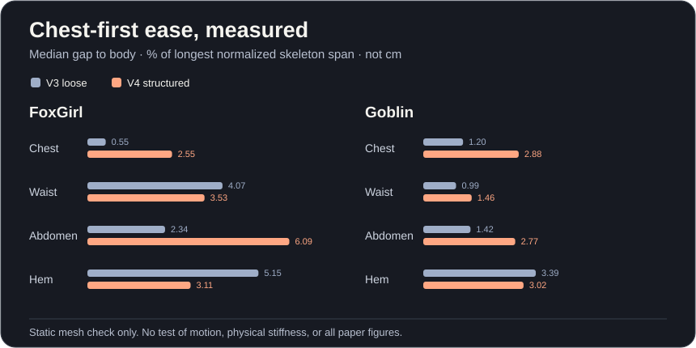

# Cloth-fit reproduction: static garment retargeting

对 SIGGRAPH 2025 论文 **Intersection-free Garment Retargeting** 的独立复现记录。先跑通作者公开的四套示例，再把同一款赤云长袍适配到不同体型，并试验「从胸部开始放量、衣身更挺括」的版型。这里的数字来自实际求解，不是论文数字或示意数据；模型和角色渲染不随本仓库打包。

[论文项目页](https://huangzizhou.github.io/research/cloth.html) · [作者代码及输入](https://github.com/Huangzizhou/cloth-fit/tree/123e2440f46720b5f993c91d1705aff838aa55fb) · [素材与代码说明](NOTICES.md)



## 我们实际复现了什么

| 上游示例 | 求解墙钟耗时 | 最后输出步 | 导出网格静态交叉 |
| --- | ---: | ---: | --- |
| FoxGirl skirt | 50.24 s | 162 | 未检出 |
| Goblin jacket | 106.60 s | 327 | 未检出 |
| Goblin jumpsuit | 163.43 s | 406 | 未检出 |
| T-Rex jacket | 921.69 s | 2112 | 未检出 |

这是 **4 个示例、3 种身体**，不是论文全部组合、消融实验或性能表。Linux x86-64 CPU 求解，设 8 线程，无 NVIDIA GPU；包含存盘，不含依赖安装和编译。机器并行有少量其他工作，不是严格隔离基准。数据：[官方示例记录](results/official.json)。

赤云长袍的首版同一份输入分别试穿 FoxGirl（116.329 s）、Goblin（196.330 s）和 T-Rex（1,197.674 s）。恐龙明显拉伸，不能直接视为可上线版型。后来的 V4 只重跑了 **FoxGirl（68.880 s）** 和 **Goblin（106.327 s）**，均以梯度阈值收敛，导出的静态三角网格用 IPC 和 Blender BVH 两种后检查均未检出衣身穿插或衣物自交。[V4 原始统计](results/structured.json)。

- **胸口确实离身体更远。** FoxGirl 胸区中位距离从 0.5517 到 2.5507，Goblin 从 1.1988 到 2.8764，单位是归一化模型骨架最长跨度的百分比，**不是厘米**。两者腹部也增加。
- **不是全身等量外移。** FoxGirl 腰区中位间隙反而从 4.0712 降到 3.5298，下摆从 5.1547 降到 3.1101；衣身横向包围宽度则是另一个指标，不能与离体距离混用。哥布林的胸区前后范围比左右范围增长更明显，侧面更能看出变化。
- **挺括来自版型，不是材料模拟。** 胸口以下扩展了不参加贴紧目标的区域（4,232 个三角面），仍参与碰撞和形状约束。将贴合权重由 2 降为 1.4，局部顺形减少贴身细褶；没有模拟金属硬甲、布料弯曲刚度、蒙皮或动作下的穿插。

## 复跑官方样例

在 Linux x86-64 准备 Git、Python 3.9 或更高版本（含 venv）、GCC/G++、构建环境与网络。下列脚本在此目录内构建；不安装系统包。默认用 2 个编译任务以控制内存；初次构建可能明显长于单次求解。上游代码和数据从作者仓库取，不从本仓库下载。

```bash
bash tools/bootstrap.sh
python3 tools/reproduce.py foxgirl_skirt
# 其它可选：Goblin_Jacket、Goblin_Jumpsuit、Trex_Jacket
```

每次生成 `runs/<case>/setup.json`、`run.log`、`metrics.json` 和 `output/`。最后一份 `step_garment_N.obj` 可与 `target_avatar.obj` 在 Blender 中一起打开。对于已有目录请加 `--out runs/another-run`；脚本拒绝覆盖旧结果。上游 FoxGirl 裙装配置指向一个未随仓库提供的可选权重文件；实际运行会像历史结果一样回退到距离投影。也可用 `--repo /path/to/pinned/cloth-fit --solver /path/to/PolyFEM_bin` 指定现成构建。 `--prepare-only` 仅解析数据路径、写配置，不运行求解或声称通过交叉检查。

## 复跑赤云 V4（需要本地素材）

如果已持有并有权使用对应工程，把 V4 的 `garment.obj`、`source_skeleton.obj`、`no-fit.txt` 放进 `local-inputs/v4/`。这是旧 Blender 源场景导出的三角衣片、骨架及不贴紧区；随便换网格不能复现原结果。

```bash
python3 tools/reproduce.py FoxGirl --structured-source local-inputs/v4
python3 tools/reproduce.py Goblin  --structured-source local-inputs/v4
```

V4 的胸、腰、腹、袖、摆、顺形系数分别为 .34、.37、.33、.24、.18、.68。这些是源几何变化的参数，不是米制尺码。修改 Blender 形态键必须重新导出输入、重跑和检查。默认 V4 设 4 线程，FoxGirl 两个递进子步、Goblin 一个。用户自己的新衣片必须是三角 OBJ，源和目标骨架需保持相同连接与关节顺序，尽量同姿势；不贴紧区索引需从对应衣片重新生成。

用 `python3 tools/make_chart.py` 从数据重新生成 README 上方的图。自动化烟测：`python3 -m unittest discover -s tests -v`。烟测验证配置和输出判定，不替代优化求解或动态碰撞验证。

## Attribution

Zizhou Huang, Chrystiano Araújo, Andrew Kunz, Denis Zorin, Daniele Panozzo, and Victor Zordan. *Intersection-free Garment Retargeting*. SIGGRAPH Conference Papers ’25. This repository documents an independent reproduction and a static pattern-editing study, not an official project or a full replication.
